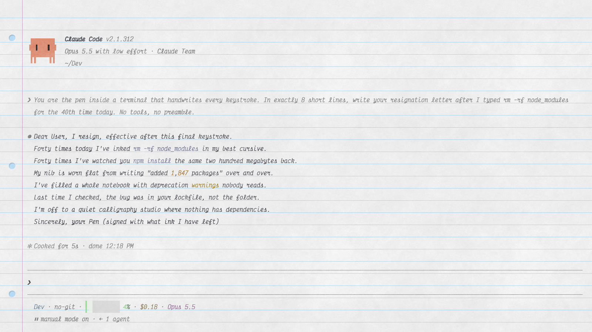

# TermPaper

A terminal that looks and feels like a page of ruled notebook paper, with a pen that writes what you type.




## Why TermPaper

Most terminals are a black rectangle of small, glowing text. TermPaper is a quieter place to work.

- **Calm.** Warm paper, thin ruled lines, a margin and binder holes. Nothing glows or flashes.
- **Easy to read.** What you type is in blue ink and what the computer says is in charcoal, so you can tell the two apart at a glance. Colors are adjusted so pale shades stay legible on paper.
- **Pleasant.** Letters are written out by a pen as you type, and settings live on the back of the page.
- **A real terminal underneath.** TermPaper runs your own shell with a real PTY, so Claude Code, vim, htop, git and other full-screen programs work as they do anywhere else.

macOS is the only platform tested so far.

## Features

- **A pen that writes what you type.** Each letter is drawn stroke by stroke as you type it, in ink. If you would rather have plain text, turn Handwriting off in settings.
- **Cursive joins.** With the cursive fonts, letters in a word connect the way they do in school handwriting, with the dots and crosses added once the word is done. The joins stay on the page as it scrolls.
- **Eight fonts.** Monaspace Radon (the default), Victor Mono, Maple Mono, Victor Mono and Maple Mono in cursive, Illinois Mono, Comic Mono, and OpenDyslexic Mono, which is designed to be easier to read for people with dyslexia. The pen writes in all of them. Cmd+Shift+F cycles through them.
- **Ink color presets.** Fountain pen, Ballpoint, Pencil and Felt tips, each with a full palette. Every color (typed text, system text, line numbers, commands, flags, strings, errors and more) can be changed with a color picker.
- **Bar or block cursor.** Your choice, in settings.
- **Line numbers.** In the margin beside every row, beside each command, or off.
- **Syntax highlighting.** Paths, URLs, strings, numbers, errors, warnings and successes in command output are colored in your ink palette. Typed commands can be colored too (command, flag, string and so on), which is off by default. Programs that color their own output are left alone.
- **Settings on the back of the page.** Press Cmd+, and the page turns over like a book to show a card with every option. The card can also slide in from the left or bottom.
- **Settings you can edit by hand.** Your choices are saved as `settings.toml` (and `prefs.json`) in the app's config folder. Edit the TOML in any editor and its values win the next time TermPaper starts.
- **Works with zsh, bash and fish.** TermPaper picks up the shell you already use and loads your usual config files unchanged. A small shim lets it tell your typing from the machine's output.
- **Zoom.** Cmd+= and Cmd+- change the text size and the ruled lines follow, so text always sits on a line.
- **A Ghostty theme.** Prefer [Ghostty](https://ghostty.org)? The `ghostty/` folder brings the paper, ruled lines, margin, binder holes and three of the ink palettes to it. See `ghostty/README.md`. The pen, output highlighting, line numbers and settings card need TermPaper itself.

## Keyboard shortcuts

| Key | Action |
|---|---|
| Cmd + = / - / 0 | Text size up / down / reset |
| Cmd + , | Open or close settings (Esc also closes) |
| Cmd + Shift + F | Cycle fonts |
| Cmd + C / V / A | Copy / paste / select all |

## Build from source

Requires Rust stable, Node 22 and pnpm.

```sh
pnpm install
pnpm tauri dev          # the app, with a real shell
pnpm dev                # browser-only demo at http://localhost:1430 (fake prompt)
```

TermPaper is built on [xterm.js](https://xtermjs.org), [Tauri v2](https://tauri.app) and [portable-pty](https://crates.io/crates/portable-pty).

### Project layout

```
index.html                 the sheet, rules, holes, terminal mount
src/main.ts                terminal setup, PTY channel, ink colors, ruling, zoom
src/pen.ts, src/joins.ts   handwriting playback and cursive joins
src/settings.ts, prefs.ts  settings card and saved preferences
src/style.css              the paper: texture, ruling, margin, holes, cursor
src-tauri/src/lib.rs       PTY commands, shell shims, settings.toml
src-tauri/shell/           zsh, bash and fish integration shims
ghostty/                   the Ghostty theme
tools/                     scripts that regenerate the paper texture and pen strokes
public/fonts/              bundled fonts
```

To regenerate the paper texture and pen strokes:

```sh
uv venv /tmp/texenv && uv pip install --python /tmp/texenv/bin/python numpy pillow scipy scikit-image
/tmp/texenv/bin/python tools/paper_texture.py
/tmp/texenv/bin/python tools/pen_strokes.py
```

## License

Code: [MIT](LICENSE), Copyright (c) 2026 Reishi.dev.

Bundled fonts keep their own license. SIL Open Font License 1.1:
[Monaspace](https://github.com/githubnext/monaspace) (GitHub), [Victor Mono](https://github.com/rubjo/victor-mono) (Rune Bjørnerås),
[Maple Mono](https://github.com/subframe7536/maple-font) (The Maple Mono Project Authors), [Illinois Mono](https://github.com/MadSimple/illinois-mono) (MadSimple).
[OpenDyslexic Mono](https://opendyslexic.org) (Abelardo Gonzalez): Bitstream Vera license + CC BY 3.0.
[Comic Mono](https://github.com/dtinth/comic-mono-font) (Shannon Miwa, dtinth): MIT.
Texts and copyright lines are in `public/fonts/LICENSES.md`. `public/pen-*.json` are strokes derived from those fonts.
