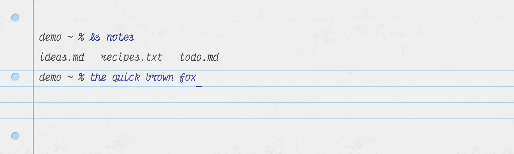

# TermPaper



A cross-platform terminal that looks like a sheet of ruled notebook paper. Monaspace Radon handwriting font (Victor Mono, Maple Mono, both also cursive, Illinois Mono, OpenDyslexic Mono and Comic Mono are in settings),
fountain-pen-blue ink for what you type, charcoal for what the machine says, and an invisible pen that writes
each letter (Handwriting in settings turns it off).

Built on [xterm.js](https://xtermjs.org) + [Tauri v2](https://tauri.app) + [portable-pty](https://crates.io/crates/portable-pty).

## Run

```sh
pnpm install
pnpm tauri dev          # app with a real shell
pnpm dev                # browser-only demo mode at http://localhost:1430 (fake prompt, local echo)
```

Requires Rust stable, Node 22, pnpm. macOS is the tested platform; Linux/Windows build but are unverified.

Debug: `http://localhost:1430/?pen=slow` plays the handwriting at 1/20 speed.

## Keys

| Key | Action |
|---|---|
| Cmd/Ctrl + = / − / 0 | Font size up / down / reset (ruling re-locks) |
| Cmd/Ctrl + , | Settings: font, handwriting on/off, size, line numbers (every row / each command / off), syntax highlighting (output on, typed commands off by default), ink theme presets with per-color pickers. Saved to `prefs.json` in the app config dir |
| Cmd/Ctrl + Shift + F | Cycle font, in the settings list's alphabetical order: Comic Mono → Illinois → Maple Mono → Maple Cursive → Radon → OpenDyslexic → Victor Mono → Victor Cursive (remembered; `?font=maple-cursive` in demo) |
| Cmd+C / Cmd+V / Cmd+A | Copy / paste / select all (macOS Edit menu) |

## Shell integration

zsh only, automatic: the app sets `ZDOTDIR` to an embedded shim (`src-tauri/shell/zsh/`) that sources your real
`.zshenv`/`.zshrc`, then adds OSC 133 prompt marks and turns off zsh's paste/yank standout highlight. Your files
are untouched. Other shells get all-charcoal text and a 2 s input delay at startup instead of prompt detection.

## Layout of the code

```
index.html                 sheet, rules, holes, header (drag strip), terminal mount
src/main.ts                xterm setup, PTY channel, write queue, OSC 133 → ink, SGR remaps, ruling, zoom, traffic lights
src/pen.ts                 handwriting playback for typed characters
src/style.css              everything paper: texture, ruling, margin, holes, deboss, cursor, scrollbar, pen overlay
src-tauri/src/lib.rs       spawn/write/resize PTY commands, zsh shim install, macOS traffic-light fade
src-tauri/shell/zsh/       ZDOTDIR shim (.zshenv, .zshrc)
tools/paper_texture.py     regenerates public/paper.png
tools/pen_strokes.py       regenerates public/pen-strokes.json from the Radon TTF
tools/joinlab.html         draws cursive letter pairs with their joins; ?grid=abc shows the pair grid over Dancing Script to compare (pnpm dev, open /tools/joinlab.html)
public/fonts/              Radon, Victor Mono, Maple Mono woff2; Illinois Mono, OpenDyslexic Mono, Comic Mono ttf/otf
public/pen-*.json          handwriting strokes per font (tools/pen_strokes.py <ttf> <out>, TTFs in fonts-src/)
```

## Regenerating assets

```sh
uv venv /tmp/texenv && uv pip install --python /tmp/texenv/bin/python numpy pillow scipy scikit-image
/tmp/texenv/bin/python tools/paper_texture.py
/tmp/texenv/bin/python tools/pen_strokes.py      # also writes /tmp/strokes_debug.png to eyeball stroke order
```

## Tuning knobs

| What | Where |
|---|---|
| Paper grain | `tools/paper_texture.py` weights, `img = 246 + tex * 3.5` |
| Ruling / margin / hole colors | `:root` vars in `src/style.css` |
| Deboss depth | `.xterm .xterm-rows span { text-shadow }` |
| Baseline on the rule | `--baseline-shift` = fontSize / 3 in `applyRuling()` |
| Ink colors | `INK`, `GRAPHITE`, theme palette in `src/main.ts` |
| Pen speed | `SPEED_EM_PER_S`, `MIN_MS`, `MAX_MS`, `LIFT_MS` in `src/pen.ts` |
| Traffic-light zone / timing | `ZONE`, durations in `watchTrafficLights()` |

## Ghostty

`ghostty/` has the same look for stock [Ghostty](https://ghostty.org) (themes, paper texture, shader, zsh helper). See `ghostty/README.md`.

## License

Code: [MIT](LICENSE), Copyright (c) 2026 Reishi.dev.

Bundled fonts keep their own license. SIL Open Font License 1.1:
[Monaspace](https://github.com/githubnext/monaspace) (GitHub), [Victor Mono](https://github.com/rubjo/victor-mono) (Rune Bjørnerås),
[Maple Mono](https://github.com/subframe7536/maple-font) (The Maple Mono Project Authors), [Illinois Mono](https://github.com/MadSimple/illinois-mono) (MadSimple).
[OpenDyslexic Mono](https://opendyslexic.org) (Abelardo Gonzalez): Bitstream Vera license + CC BY 3.0.
[Comic Mono](https://github.com/dtinth/comic-mono-font) (Shannon Miwa, dtinth): MIT.
Texts and copyright lines are in `public/fonts/LICENSES.md`. `public/pen-*.json` are strokes derived from those fonts.
